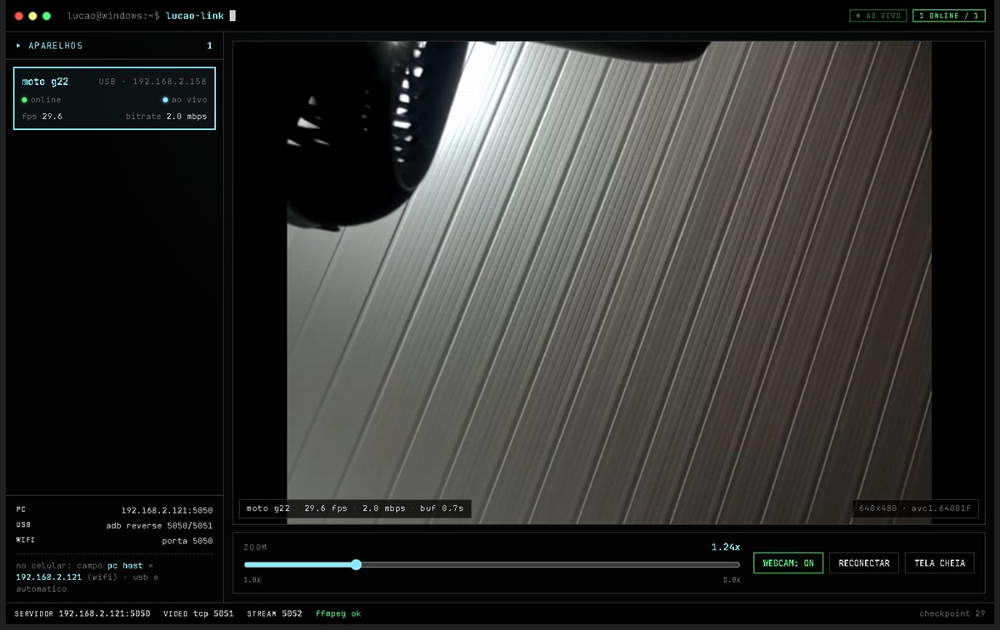

# LUCAO LINK

**Transforme um celular Android em uma webcam para o seu PC Windows — por USB ou
Wi‑Fi, dentro de uma única janela.**



[](#requisitos)
[](#requisitos)
[](CHANGELOG.md)
[](LICENSE)

O LUCAO LINK transmite a câmera do celular para um app desktop em Electron.
Conecte o celular e a imagem aparece — sem `ffplay`, sem aba de navegador, sem
conexão manual.

O mesmo servidor de controle alimenta o painel Android e a janela do desktop,
então zoom, estado da webcam e status da conexão ficam sincronizados dos dois
lados.

---

## Destaques

- **Plug and play via USB.** O companion instala o APK embutido, cria os túneis
  `adb reverse` e abre o app no celular.
- **Fallback por Wi‑Fi.** Sem USB, o celular se conecta direto ao PC.
- **Player embutido de baixa latência.** O H.264 é remuxado para MP4 fragmentado
  e reproduzido com Media Source Extensions; o player sempre busca a borda ao
  vivo.
- **Controle pelo PC.** Zoom (1x–8x), webcam ligada/desligada, reconectar e tela
  cheia.
- **Vários celulares ao mesmo tempo**, cada um com sua própria sessão, HUD e
  controles.
- **Autorrecuperação.** Watchdogs dos dois lados recuperam de câmera travada,
  socket preso ou `adb reverse` caído.

## Requisitos

| Componente | Requisito |
|---|---|
| Windows | 10 / 11 x64 |
| Android | 8.0+ (API 26); depuração USB para o modo USB |
| Node.js | 20+ (apenas para desenvolvimento e build) |
| ffmpeg | no `PATH`, ou defina `FFMPEG_PATH` |
| adb | platform-tools no `PATH` (modo USB) |

## Início rápido

### Build portable

1. Obtenha `dist/LUCAO-LINK-1.2.0-portable.exe` (veja [gerando o portable](#gerando-o-portable)).
2. Garanta que `adb` e `ffmpeg` estejam no `PATH`.
3. Dê dois cliques nele e conecte o celular.

A primeira execução instala o APK embutido e abre o LUCAO LINK no celular. O
vídeo aparece sozinho.

### A partir do código-fonte

```bash
npm install
npm start        # electron .
```

A mesma interface também funciona no navegador em <http://127.0.0.1:5050/app/>.

### Gerando o portable

```bash
npm run dist     # -> dist/LUCAO-LINK-<version>-portable.exe
```

O APK Android é embutido como recurso, então uma máquina nova só precisa de
`adb` e `ffmpeg`.

### Gerando o app Android

```bash
cd android
gradlew.bat :app:assembleDebug --offline
# -> android/app/build/outputs/apk/debug/app-debug.apk
```

Recrie o APK antes de rodar `npm run dist` se você alterou o lado Android — a
etapa do electron-builder apenas empacota o arquivo já existente.

## Como funciona

```text
Android · CameraForegroundService
  CameraX 640x480 @ 30 fps  ->  MediaCodec (H.264)  ->  TCP
        │  handshake: LUCAO/1 <deviceId> <name> <usb|wifi>
        ▼
PC · video-bridge  (:5051)  ->  ffmpeg -c:v copy  ->  MP4 fragmentado
        │
        ▼
PC · HTTP  (:5052)  /info/:id  /stream/:id  /health
        │
        ▼
Janela Electron  (player MSE)  <-  server.js  (:5050)  API + UI
```

### Portas

| Porta | Protocolo | Função |
|---|---|---|
| 5050 | HTTP | API de controle, painel Android e UI do desktop |
| 5051 | TCP | H.264 bruto vindo do celular |
| 5052 | HTTP | MP4 fragmentado para o player |

### USB vs Wi‑Fi

- **USB (preferido).** O companion roda `adb reverse tcp:5050` e `tcp:5051`, então
  o celular fala com `127.0.0.1`. O túnel é revalidado a cada 10 s e restaurado
  se cair.
- **Wi‑Fi.** O celular se conecta ao endereço do PC na LAN diretamente. Use o
  campo `pc host` no celular se a autodetecção escolher a interface errada.

A ponte aceita os dois transportes e informa qual está em uso, então alternar
entre eles é transparente para o player.

## Usando o app

| Controle | Ação |
|---|---|
| Lista de dispositivos (à esquerda) | Seleciona o celular a assistir |
| ZOOM | 1x–8x, aplicado ao CameraX no celular |
| WEBCAM | Câmeras ligadas/desligadas no celular |
| RECONECTAR | Derruba a sessão e reconecta |
| TELA CHEIA | Player em tela cheia (`Esc` sai) |
| `F12` / `Ctrl+Shift+I` | DevTools |

### Estados do player

| Estado | Significado |
|---|---|
| `AGUARDANDO VÍDEO` | Celular online, mas sem transmitir |
| `CONECTANDO` | Sessão aberta, aguardando o primeiro SPS/PPS |
| `SEM FRAMES` | Sessão aberta, sem codec após 12 s — abra a câmera ou reconecte |
| `AO VIVO` | Reproduzindo na borda ao vivo |

O player também detecta imagem congelada: 6 s sem dados novos disparam um pedido
de reconexão sem derrubar a página.

## Resiliência

| Camada | Regra |
|---|---|
| Android | 5 s sem escrever vídeo → derruba o socket e reconecta |
| Android | 3 s sem frames da câmera → religa o CameraX (no máximo a cada 10 s) |
| Android | comando `reconectar` → derruba o socket sob demanda |
| PC · `main.js` | A cada 4 s: sessão ausente ou sem codec por 15 s → pede reconexão |
| PC · companion | A cada 10 s: restaura o `adb reverse` se o túnel desapareceu |
| Player | Sem dados por 6 s → pede reconexão; mantém o player atual |

Fechar e reabrir o app desktop não exige nada no celular: o companion restaura o
túnel e o celular se reconecta sozinho.

## Solução de problemas

| Sintoma | O que fazer |
|---|---|
| `A porta 5050 já está em uso` | Feche outro LUCAO LINK ou o `node server.js` |
| Celular não aparece na lista | Ative a depuração USB, aceite a autorização, verifique `adb devices` |
| `adb device unauthorized` | Aceite o diálogo no celular, ou rode `adb kill-server` e tente de novo |
| Travado em `CONECTANDO` / `SEM FRAMES` | Abra a câmera no celular, ou pressione RECONECTAR |
| `ffmpeg` aparece como ausente no rodapé | Instale o ffmpeg e coloque no `PATH` (ou `FFMPEG_PATH`) |
| Vídeo funciona no USB mas não no Wi‑Fi | Preencha o endereço do PC no campo `pc host` |
| Celular sumiu após reconectar o cabo | Espere ~10 s; o companion restaura os túneis |

Os logs são gravados em `%APPDATA%\LUCAO LINK\lucao-link.log`.

## Estrutura do projeto

```text
LUCAO-CAM/
├── android/                 App Android (Kotlin, CameraX, MediaCodec)
│   └── app/src/main/java/com/lucao/link/
├── pc/
│   ├── app/                 App desktop Electron
│   │   ├── main.js          janela, detecção de ffmpeg, watcher de vídeo, IPC
│   │   ├── video-bridge.js  TCP 5051 -> ffmpeg -> fMP4 na 5052
│   │   └── ui/              UI com tema de terminal e player MSE
│   └── companion/           adb: instala o APK, abre o app, adb reverse
├── docs/
│   ├── screenshot.jpg
│   └── checkpoints.md       notas de marcos arquivadas
├── server.js                API de controle + painel Android (:5050)
├── package.json             config do Electron e do electron-builder
├── CHANGELOG.md
└── README.md
```

## Notas

- O SPS gerado pelo CameraX carrega um VUI quebrado (~1.200.000 fps). A ponte
  passa `-r 30` antes de `-i`, então o MP4 fragmentado ganha timestamps reais de
  30 fps sem reencodificar.
- A string de codec é lida da caixa `avcC`; o MSE precisa do MIME completo
  (`video/mp4; codecs="avc1.64001f"`).
- As portas são fixas. O app mantém um lock de instância única e tenta novamente
  por alguns segundos quando o processo anterior ainda está encerrando.
- A captura de tela ainda não está implementada; apenas a câmera é transmitida.

## Testado com

```text
Dispositivo   Motorola Moto G22 (Android 12 / API 31)
USB           29,5–30 fps · 640x480 · avc1.64001f · ~2 Mbps
Wi-Fi         29,5 fps na mesma LAN
Encoder       c2.mtk.avc.encoder
Desktop       Windows 11 · Electron 45 · ffmpeg 9
```

## Roadmap

- [x] Captura com CameraX, codificação H.264 em hardware
- [x] Transporte USB com `adb reverse`
- [x] Transporte por Wi‑Fi
- [x] ~30 fps estáveis, reconexão automática
- [x] UI de terminal com zoom e controle da webcam pelo PC
- [x] Sessões multi-dispositivo
- [x] App desktop com player embutido e build portable
- [ ] Captura e transporte do microfone
- [ ] Seleção de câmera/lente (frontal, ultra-wide, teleobjetiva)
- [ ] Ajustes de exposição, foco e imagem
- [ ] Webcam e microfone virtuais para outros apps do Windows

## Segurança

O LUCAO LINK é feito para redes locais confiáveis. A API não tem autenticação
nem criptografia: não exponha as portas 5050–5052 à internet.

Nunca faça commit de keystores, tokens ou credenciais. Artefatos de build
(`dist/`, `build/`, `*.apk`) e capturas brutas (`*.h264`) são ignorados.

## Documentação

- [CHANGELOG.md](CHANGELOG.md) — o que mudou em cada checkpoint
- [docs/checkpoints.md](docs/checkpoints.md) — histórico completo dos marcos anteriores

## Licença

[MIT](LICENSE)
